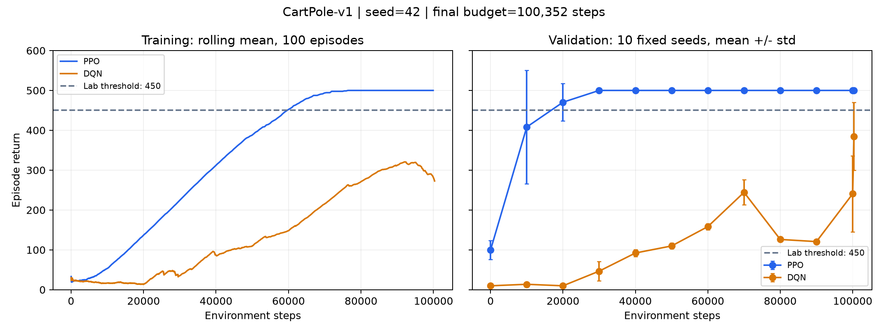

# Лабораторная работа № 6

Обучение мини-RL агента в игровой среде. Дисциплина «Игровой искусственный интеллект».

**Студент:** Печенов В. В. · **Группа:** ИВТ-465 · **Дата:** 17.11.2026.
**Стек:** Python / Gymnasium / Stable-Baselines3 / PyTorch / TensorBoard.

**[Отчёт PDF, 6 страниц](docs/report.pdf)** · **[Отчёт Markdown](docs/report.md)** ·
**[Видео: пять полных эпизодов](https://drive.google.com/file/d/1nLk3H5OV0YQchjVa4kzpn48OO6WsL1uk/view?usp=drivesdk)** ·
**[Release v1.0: модели, TensorBoard и резервное видео](https://github.com/VladimirPechenov/lab06-rl-agent/releases/tag/v1.0)**

## Выполнение требований

- [x] Реально обученный PPO выше порога CartPole: **500,00 ± 0,00 >= 450** на 20 эпизодах.
- [x] Сравнение **PPO и DQN** при одинаковых 100352 шагах среды.
- [x] Графики обучающей и независимой валидационной награды, исходные данные сохранены.
- [x] Видео **5 полных эпизодов** PPO на новых seed, 50 секунд, без ускорения и вырезаний.
- [x] Видео на Google Диске с доступом всем по ссылке; MP4 исключена из Git.
- [x] MDP, гиперпараметры в YAML, отчёт по всем разделам шаблона, 6 страниц.
- [x] Последовательные коммиты `step-1` и далее, тег `v1.0`, Release, GitHub Actions.

Источник: [задание преподавателя](https://github.com/kolesnikov-vstu-gameai/lab06-rl-agent).
Подробная сверка: [docs/requirements.md](docs/requirements.md).
Пользователь подтвердил, что других материалов нет. Отдельный официальный титульный лист и
ФИО преподавателя отсутствуют; соответствие непредоставленному кафедральному макету не заявляется.

## Фактические результаты

CartPole-v1, финальные модели, действия `deterministic=True`, 20 эпизодов seed=2000..2019.
Std - стандартное отклонение наград эпизодов с `ddof=0`.

| Алгоритм | Шаги обучения | Средняя награда ± std | Min / max | Время, с | Порог 450 |
|---|---:|---:|---:|---:|---|
| PPO | 100352 | **500,00 ± 0,00** | 500 / 500 | 110,6 | выполнен |
| DQN | 100352 | 353,75 ± 66,96 | 211 / 465 | 73,8 | не достигнут |

Время включает создание модели и периодическую валидацию. Обучения выполнялись одновременно,
поэтому эти времена нельзя интерпретировать как чистый бенчмарк скорости алгоритмов.



Слева - средняя награда последних 100 завершённых обучающих эпизодов (вначале всех доступных).
Справа - оценка на 10 одинаковых seed=1000..1009 через каждые 10000 шагов и в конце;
отрезки показывают ±std, а не доверительные интервалы. Обучающая награда DQN включает исследование,
валидация использует детерминированную политику. Последние точки 100000 и 100352 близки на оси.

PPO достиг 470,4 на валидации к 20000 шагам, затем 500 к 30000 и удерживал результат до конца.
DQN колебался; при этом бюджете финальная модель порог не прошла. Требование об успешном агенте
выполняет PPO. Один training seed на алгоритм ограничивает обобщение; общего превосходства PPO
над DQN этот опыт не доказывает. Подбора параметров и выбора checkpoint по итоговым тестам не было.

## MDP и протокол

[Полное описание MDP](docs/mdp.md): четыре компонента состояния (x, v, угол, угловая скорость),
два дискретных действия, +1 за каждый шаг, максимум 500. Падение/выезд дают `terminated`,
временной лимит - `truncated`; оба завершают эпизод. Награда и среда не изменены.

- Обучение: seed=42, CPU, один поток PyTorch.
- Валидация: 10 эпизодов, seed=1000..1009; не используется для выбора весов.
- Итоговая проверка: 20 отдельных эпизодов, seed=2000..2019, финальная модель.
- Видео: пять новых seed=3000..3004; все пять наград равны 500, `truncated=True`.

**Изменения относительно шаблона:** бюджет 100000 → 100352 у обоих алгоритмов,
поскольку PPO собирает полные блоки по 2048 шагов (49 блоков). Это обеспечивает равное
фактическое число взаимодействий со средой. Параметры оптимизации сохранены из шаблона:

| Параметр | PPO | DQN |
|---|---|---|
| learning_rate | 0.0003 | 0.001 |
| gamma | 0.99 | 0.99 |
| n_steps / batch_size | 2048 / 64 | — / 32 (SB3 default) |
| buffer_size | — | 50000 |
| exploration_fraction | — | 0.2 |

Изменяемые параметры только в `configs/*.yaml`; выполненная конфигурация целиком сохранена
в `results/<algo>/train.json`. Сети MlpPolicy штатные: PPO actor/critic 64–64 с Tanh,
DQN Q-сеть 64–64 с ReLU. Другие defaults определяются закреплённой SB3 2.7.1.
Из зависимостей исключён Box2D: он не требуется выбранной CartPole.

## Установка и проверка

Python **3.12**, проверено на Windows. Базовый запуск:

```powershell
py -3.12 -m venv .venv
.\.venv\Scripts\python.exe -m pip install -r requirements.txt
.\.venv\Scripts\python.exe -m pytest
.\.venv\Scripts\python.exe -m ruff check .
.\.venv\Scripts\python.exe -m lab06.audit
.\.venv\Scripts\python.exe -m lab06.plot
```

Linux/macOS: `python3 -m venv .venv` и `.venv/bin/python` вместо Windows-пути.
CI использует Python 3.11. API-ключи и GPU не требуются.
Для точных версий проведённого Windows-эксперимента: `pip install -r requirements-lock.txt`,
затем `pip install -e . --no-deps`. Состав версий также в `results/*/train.json`.

Проверки включают повторяемость seed, оба флага завершения, невозможность пустой оценки,
весь сохранённый эксперимент, пересчёт средних и std, число шагов и соответствие хешей.

## Проверка сохранённых моделей

Скачайте `lab06_artifacts.zip` из [Release v1.0](https://github.com/VladimirPechenov/lab06-rl-agent/releases/tag/v1.0)
и распакуйте **в корень проекта**. В нём `models/ppo.zip`, `models/dqn.zip` и `runs/`.
Веса и события TensorBoard не включены в Git. Через GitHub CLI:

```powershell
gh release download v1.0 --repo VladimirPechenov/lab06-rl-agent --pattern lab06_artifacts.zip
Expand-Archive -LiteralPath lab06_artifacts.zip -DestinationPath .
.\.venv\Scripts\python.exe -m lab06.audit --models
.\.venv\Scripts\python.exe -m lab06.evaluate --algo ppo
.\.venv\Scripts\python.exe -m lab06.evaluate --algo dqn
.\.venv\Scripts\python.exe -m lab06.record --algo ppo
.\.venv\Scripts\tensorboard.exe --logdir runs
```

Переоценка обновляет `results/eval_<algo>.json`, запись - соответствующие видео и манифест.
При другом окружении допускаются численные отличия; сохранённый исходный прогон содержит хеши
и результаты всех эпизодов для независимой проверки.

## Новое обучение

Для защиты от случайной потери результатов обучение отказывается перезаписывать существующий
эксперимент. Перед новым прогоном перенесите `results/ppo` и `results/dqn` в архивную папку,
также сохраните прежние `models/`, `runs/` и итоговые JSON, если они нужны.

```bash
python -m lab06.train --config configs/ppo.yaml
python -m lab06.train --config configs/dqn.yaml
python -m lab06.evaluate --algo ppo
python -m lab06.evaluate --algo dqn
python -m lab06.plot
python -m lab06.record --algo ppo
python -m lab06.audit --models
```

`Makefile` сохраняет короткие команды `make train ALGO=ppo`, `make evaluate ALGO=dqn` и т.д.
Для пересборки отчёта: `pip install -e ".[artifacts]"`, затем `python tools/build_report.py`.
Используются Arial (Windows) или DejaVu Sans (Linux).

## Файлы работы

| Путь | Содержание |
|---|---|
| `src/lab06/` | Обучение, оценка, запись, график, аудит |
| `configs/` | Выполненные конфигурации PPO и DQN |
| `results/<algo>/train.monitor.csv` | Все завершённые обучающие эпизоды |
| `results/<algo>/validation.json` | Сырые результаты каждой валидации |
| `results/<algo>/train.json` | Версии ПО, конфигурация, время, SHA-256 модели |
| `results/eval_*.json` | Все 20 итоговых эпизодов и метрики |
| `results/video_ppo.json` | Пять видеоэпизодов, кадры, частота, хеш MP4 |
| `docs/report.pdf`, `docs/report.md` | Отчёт, 6 страниц, все разделы шаблона |
| `docs/img/ppo_episode.png` | Настоящий кадр поведения агента |
| `docs/requirements.md` | Сверка опубликованных требований |
| Release `lab06_artifacts.zip` | Обе обученные модели и TensorBoard |

Документация: [Gymnasium CartPole](https://gymnasium.farama.org/environments/classic_control/cart_pole/),
[SB3 PPO](https://stable-baselines3.readthedocs.io/en/v2.7.1/modules/ppo.html),
[SB3 DQN](https://stable-baselines3.readthedocs.io/en/v2.7.1/modules/dqn.html).
