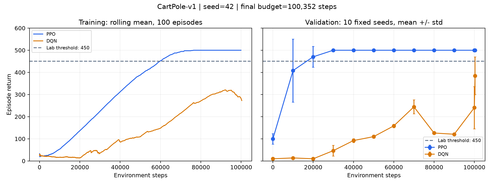

## Лабораторная работа № 6

## Обучение мини-RL агента в игровой среде

Дисциплина: «Игровой искусственный интеллект»

Студент: Печенов В. В. | Группа: ИВТ-465 | Дата: 17.11.2026

Стек: Python 3.12, Gymnasium 1.2.3, Stable-Baselines3 2.7.1, PyTorch, TensorBoard.

## 1. Цель работы

Освоить цикл обучения с подкреплением: формализовать среду как MDP, обучить агента, сравнить два алгоритма по динамике награды и проверить поведение сохранённой политики.

## 2. Постановка задачи

Выбрана CartPole-v1. Требуется получить среднюю награду не ниже 450, построить сравнительный график двух алгоритмов и записать пять эпизодов. Для PPO и DQN выделено по 100352 шага среды. Итоговая оценка - 20 отдельных эпизодов, действия детерминированы.

Результат: PPO = 500,00 ± 0,00; DQN = 353,75 ± 66,96. Порог выполняет PPO. Числа получены реальным обучением и пересчитываются из результатов каждого эпизода.

Оформление выполнено по разделам предоставленного репозитория. Отдельный кафедральный макет и ФИО преподавателя в доступных материалах отсутствуют.

## 3. Описание реализации: MDP

Состояние s = (x, v, θ, ω) содержит координату тележки, её скорость, угол шеста и угловую скорость. Наблюдение - четыре числа float32; изображения для обучения не используются.

Действия: 0 - приложить силу -10 Н, 1 - приложить +10 Н. Шаг физики равен 0,02 с. После фиксации начального состояния переходы определяются динамикой среды.

Награда: +1 на каждом шаге, включая шаг завершения. Максимум за эпизод - 500. Дисконт γ=0,99 задаёт приоритет близких наград в обучении; в таблицах приведена недисконтированная сумма наград.

Начальное состояние: независимые значения из U(-0,05; 0,05). Флаг terminated возникает при |x| > 2,4 м либо |θ| > 12°; truncated возникает на лимите 500 шагов. Оценка и видео завершают эпизод по любому из этих флагов. Ограничения наблюдения Box шире границ завершения.

## Архитектура

YAML → train.py → Monitor + TensorBoard → финальная модель ZIP. Отдельные ветви: evaluate.py → результаты 20 эпизодов; plot.py → сравнительный график; record.py → пять полных эпизодов. audit.py проверяет согласованность опубликованных чисел и хешей.

Политики MlpPolicy используют штатные сети SB3: у PPO отдельные ветви actor/critic по 64–64 нейрона с Tanh; у DQN Q-сеть 64–64 с ReLU и target network. Входы и награда не нормализуются, reward shaping отсутствует.

Порог лабораторной 450 отличается от reward_threshold=475 в спецификации Gymnasium. PPO превышает оба порога на выбранных 20 эпизодах.

## 3. Описание реализации: обучение

PPO - on-policy actor-critic: оценивает преимущества на собранных траекториях и ограничивает изменение политики с помощью clipped objective. DQN - off-policy алгоритм: обучает Q-функцию по выборкам replay buffer, использует target network и ε-greedy исследование.

PPO: learning_rate=0,0003; n_steps=2048; batch_size=64; gamma=0,99. Остальные параметры SB3 2.7.1: n_epochs=10, gae_lambda=0,95, clip_range=0,2.

DQN: learning_rate=0,001; buffer_size=50000; exploration_fraction=0,2; gamma=0,99. Штатные параметры: batch_size=32, learning_starts=100, train_freq=4, gradient_steps=1, target_update_interval=10000, exploration_final_eps=0,05.

Изменение относительно шаблона: total_timesteps=100000 заменён на 100352 у обоих алгоритмов. Это ровно 49 rollout-блоков PPO по 2048 шагов; DQN получает тот же фактический бюджет. Параметры оптимизации не подбирались по итоговым тестам. CPU, один поток PyTorch, seed=42.

## Разделение данных

Обучение использует seed=42. На шагах 0, 10000, …, 100000 и 100352 выполняется валидация на seed=1000..1009. Контрольные точки по ней не выбираются. После обучения финальные модели проверяются на seed=2000..2019; видео записано на seed=3000..3004.

Monitor сохраняет длину, награду и время каждого завершённого эпизода; JSON содержит конфигурацию, фактическое число шагов, версии библиотек и SHA-256 модели. Одинаковые seed позволяют сравнить политики при одинаковых стартовых состояниях.

Пакет Box2D исключён из зависимостей, поскольку выбрана CartPole. Он не нужен для этой среды. Точные версии окружения зафиксированы в requirements-lock.txt.

## 4. Демонстрация

Рисунок 1. Фактический кадр первого эпизода PPO, шаг 250.

Записаны пять полных эпизодов финальной PPO-политики. Каждый длится 500 шагов и приносит награду 500. Частота - 50 кадров/с; всего 2500 кадров, 50 секунд. На видео указаны номер эпизода, seed, шаг и накопленная награда.

Кадры получены из Gymnasium render_mode=rgb_array. Вырезания и ускорения отсутствуют; добавлены только текстовые счётчики. Звука нет. Видео хранится вне Git, как требует шаблон.

[Видео пяти эпизодов на Google Диске](https://drive.google.com/file/d/1nLk3H5OV0YQchjVa4kzpn48OO6WsL1uk/view?usp=drivesdk)

[Резервная MP4 и модели в Release v1.0](https://github.com/VladimirPechenov/lab06-rl-agent/releases/tag/v1.0)

results/video_ppo.json содержит seed каждого эпизода, длину, флаги завершения, число кадров и контрольные суммы видео и модели. Максимальная награда объясняется достижением временного лимита, а не остановкой записи до падения.

## 5. Метрики и результаты

| Алгоритм | Шаги | Mean ± std | Min / max | Время, с |
|---|---|---|---|---|
| PPO | 100352 | 500.00 ± 0.00 | 500 / 500 | 110.6 |
| DQN | 100352 | 353.75 ± 66.96 | 211 / 465 | 73.8 |
Рисунок 2. Обучение PPO и DQN при равном числе шагов среды.

Слева: скользящая средняя по 100 обучающим эпизодам, ранние точки используют доступные эпизоды. Справа: средняя награда и стандартное отклонение по 10 фиксированным валидационным seed. Интервалы ±std не являются доверительными интервалами.

PPO достигает 470,4 на валидации к 20000 шагам, затем 500 к 30000 и удерживает этот уровень до конца. У DQN есть рост до 244,3 на 70000 шагах и последующий спад. На 100352 шагах валидация DQN даёт 384,7; независимая итоговая оценка - 353,75.

Std рассчитано с ddof=0. Время включает создание модели и периодическую валидацию; процессы обучения запускались одновременно, поэтому время не является чистым бенчмарком скорости.

## 6. Выводы

Цель достигнута: финальный PPO удержал шест до лимита во всех 20 итоговых эпизодах и превысил порог лабораторной на 50 баллов. Сохранённая модель также прошла пять новых эпизодов видеодемонстрации. DQN при тех же шагах и параметрах шаблона порог не достиг.

Результат показывает преимущество данной PPO-конфигурации на CartPole при заданном бюджете. Он не доказывает общего превосходства PPO над DQN: на алгоритм выполнен один training seed, а оптимизация DQN и другие среды не исследованы. Повтор с несколькими seed и подбор параметров только по валидации - следующий эксперимент.

## Проверки и воспроизведение

После установки: python -m pytest; python -m ruff check .; python -m lab06.audit. Для проверки весов распакуйте lab06_artifacts.zip из Release в корень проекта и выполните python -m lab06.audit --models, затем python -m lab06.evaluate --algo ppo.

Чтобы повторить обучение, сначала переместите results/ppo и results/dqn в архив: train.py защищает сохранённый эксперимент от случайной перезаписи. Команды обучения приведены в README. Совпадение байтов модели на другой версии ПО не гарантируется.

## 7. Список литературы

[Задание и шаблон ЛР №6](https://github.com/kolesnikov-vstu-gameai/lab06-rl-agent)

[Gymnasium: CartPole-v1](https://gymnasium.farama.org/environments/classic_control/cart_pole/)

[Stable-Baselines3: PPO](https://stable-baselines3.readthedocs.io/en/v2.7.1/modules/ppo.html)

[Stable-Baselines3: DQN](https://stable-baselines3.readthedocs.io/en/v2.7.1/modules/dqn.html)

## Приложение. Ссылка на репозиторий

[https://github.com/VladimirPechenov/lab06-rl-agent](https://github.com/VladimirPechenov/lab06-rl-agent)
